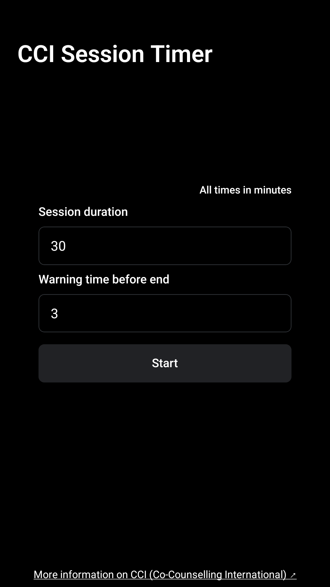
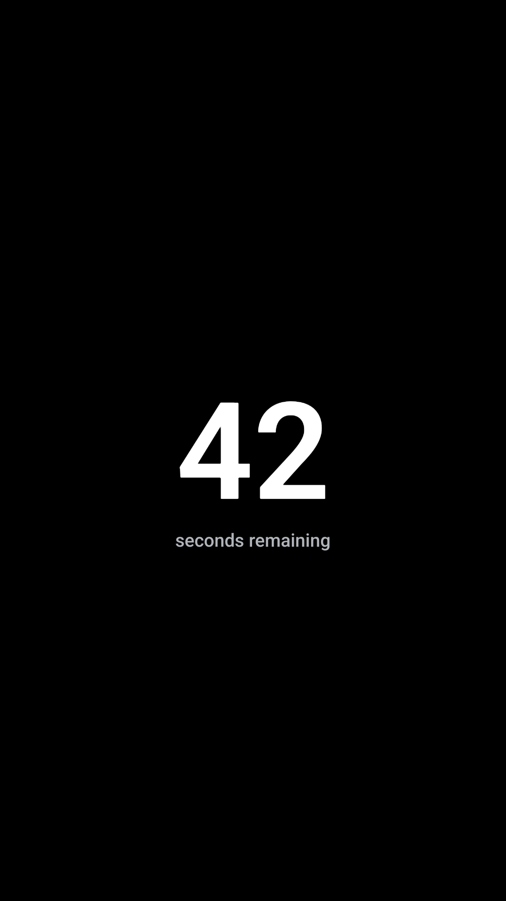
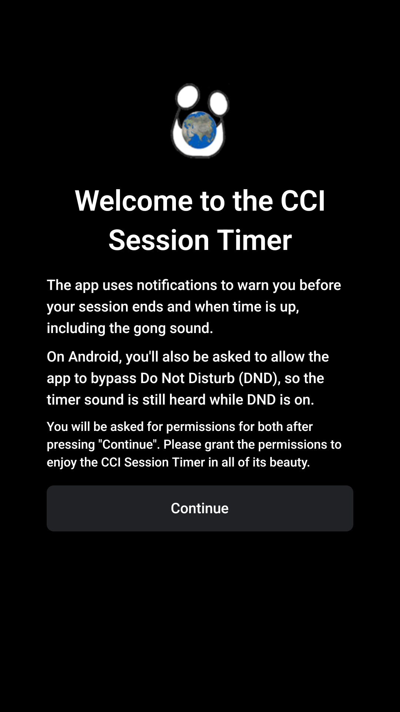

# CCI Timer

A mobile-first Expo app for configuring session duration.

CCI Session Timer is a mobile-first timer for Co-Counselling sessions.

This app is designed for Co-Counselling sessions according to the practices of Co-Counselling International (CCI).
It works for other timing purposes as well. :)

Set the length of your session and let the app keep track of the time for you so you can fully focus on the session.

The timer is designed to work even while your phone is on silent or Do Not Disturb is enabled: it can request notification-policy access and a Do Not Disturb bypass so the end-of-session sound is still heard.

## Features

- Configurable session duration
- Optional warning-time notification
- Gong sound for warning-time and when the session finishes
- Works with Do Not Disturb enabled
- Keeps screen awake during session
- Minimal, distraction-free interface

## What is CCI?

More information on Co-Counselling International: https://co-counselling.org

## Screenshots

|  |  |  |
|---|---|---|

## Installing on Android

Pre-built APKs are attached to each release on GitHub:
https://github.com/rakvat/cci-timer/releases

To install:

1. Download the `.apk` file from the latest release onto your phone (e.g. open the release page in your phone's browser).
2. Open the downloaded APK to start the install. Android will ask you to allow installing apps from unknown sources for your browser or file manager — grant it when prompted (Settings → Apps → Special app access → Install unknown apps).
3. Once installed, launch "CCI Timer" from your app drawer. You may need to allow notifications for the timer alerts to work.

## Development

Install dependencies with `npm install`, then start the Expo development server with `npx expo start`. Use `npx expo start --web` to open the web app.
